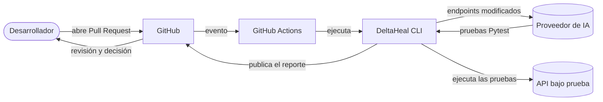

# DeltaHeal

**Generación automática de pruebas de regresión para APIs REST con IA, enfocada en los cambios
del contrato OpenAPI.**

DeltaHeal se ejecuta en cada Pull Request: detecta qué endpoints cambiaron en el contrato, solicita
a un modelo de lenguaje (LLM) pruebas solo para esos endpoints, las ejecuta contra la API, corrige
automáticamente las pruebas con errores de código y publica en el Pull Request un reporte con las
posibles regresiones.

| Problema al generar pruebas con IA | Solución de DeltaHeal |
|---|---|
| **Alto consumo de tokens**: en cada cambio se envía al modelo el contrato completo de la API | **Análisis delta**: se envían solo los endpoints modificados y los esquemas que usan. Si el contrato no cambió, no se invoca al modelo (0 tokens). |
| **Código generado que no se ejecuta** (errores de sintaxis, imports, nombres) | **Auto-corrección (self-healing)**: se ejecutan las pruebas, se capturan los errores y se solicita al modelo reparar solo las pruebas defectuosas, hasta 3 iteraciones. |

En la evaluación con 3 APIs de referencia, DeltaHeal redujo el consumo de tokens en **47 %**
respecto al envío del contrato completo y logró que el **100 %** de las pruebas generadas fueran
ejecutables, frente a un 92 %. Detalle en [Resultados](#resultados).

---

## Contenido
1. [Funcionamiento](#funcionamiento)
2. [Arquitectura](#arquitectura)
3. [Supervisión humana](#supervisión-humana)
4. [Instalación](#instalación)
5. [Demostración](#demostración)
6. [Uso con un proveedor de IA](#uso-con-un-proveedor-de-ia)
7. [Referencia de la línea de comandos](#referencia-de-la-línea-de-comandos)
8. [Integración con GitHub Actions](#integración-con-github-actions)
9. [Resultados](#resultados)
10. [Estructura del proyecto](#estructura-del-proyecto)
11. [Limitaciones](#limitaciones)
12. [Solución de problemas](#solución-de-problemas)

---

## Funcionamiento

DeltaHeal no analiza el código fuente de la API, sino su **contrato OpenAPI**: el archivo YAML/JSON
que describe cada endpoint, sus parámetros y sus respuestas.

```
 Pull Request que modifica el contrato (openapi.yaml)
                │
                ▼
 ① ¿Cambió el contrato? ──── no ───► fin (0 tokens)
                │ sí
                ▼
 ② Comparación endpoint por endpoint entre la versión base y la nueva, con referencias
    ($ref) resueltas: un cambio en un esquema marca todos los endpoints que lo usan.
                │
                ▼
 ③ El modelo genera pruebas Pytest solo para esos endpoints     ◄──────────┐
                │                                                         │
                ▼                                                         │
 ④ Ejecución de las pruebas contra la API                                 │
                │                                                         │
                ▼                                                         │
 ⑤ ¿Hay pruebas con errores de código? ── sí ──► reparación de esas pruebas ┘
                │ no                              (máximo 3 iteraciones)
                ▼
 ⑥ Reporte en el Pull Request: pruebas, cobertura, tokens y posibles regresiones
```

- Las etapas ① y ② no requieren la API ni el modelo: comparan dos versiones de un archivo.
- La etapa ④ requiere la API en ejecución, ya que las pruebas la invocan y verifican sus respuestas.
- **Principio de diseño:** la auto-corrección repara únicamente defectos del *código de prueba*.
  Las fallas de aserción (por ejemplo, la API responde 500 en lugar de 200) no se reparan, porque
  pueden corresponder a regresiones reales de la API; se reportan como **posibles regresiones**.

---

## Arquitectura

**Estilo arquitectónico: tubería y filtros (*pipes and filters*) con un bucle de
retroalimentación.** El sistema se distribuye como una **aplicación de línea de comandos (CLI)**
que se ejecuta dentro de un pipeline de **CI/CD** (GitHub Actions), activado por eventos de
Pull Request.

- **Tubería y filtros:** cada etapa recibe un artefacto, lo transforma y lo entrega a la siguiente
  (contrato → delta → pruebas → resultados → reporte). Cada etapa es un módulo independiente y
  verificable por separado.
- **Bucle de retroalimentación:** los resultados de la ejecución (etapa ④) se envían al modelo para
  reparar las pruebas (etapa ⑤).
- **Monolito modular sin estado:** cada ejecución es un proceso que termina al generar el reporte.
  No requiere servidor ni base de datos.
- **Patrones de diseño:**
  - **Adaptador y Fábrica** para los proveedores de IA: todos implementan la interfaz
    `complete()` y `make_client()` instancia el proveedor configurado (Gemini, Groq, Ollama,
    OpenAI, DeepSeek, Anthropic o un cliente simulado).
  - **Plugin** de Pytest: provee la fixture `api` y registra cada petición HTTP para medir la
    cobertura.
  - **Estrategia** para los modos de ejecución: el mismo flujo, con el análisis delta y la
    auto-corrección activables por configuración.



**Etapas y módulos** (paquete [deltaheal/](deltaheal/), coordinado por
[pipeline.py](deltaheal/pipeline.py)):

| Etapa | Módulos |
|---|---|
| ① Carga del contrato (archivo o git) | [spec_loader.py](deltaheal/spec_loader.py) |
| ② Análisis delta | [delta.py](deltaheal/delta.py) |
| ③ Generación de pruebas | [prompts.py](deltaheal/prompts.py), [llm.py](deltaheal/llm.py), [generated_code.py](deltaheal/generated_code.py) |
| ④ Ejecución | [pytest_runner.py](deltaheal/pytest_runner.py), [pytest_plugin.py](deltaheal/pytest_plugin.py) |
| ⑤ Auto-corrección | [self_healing.py](deltaheal/self_healing.py), [partial_repair.py](deltaheal/partial_repair.py) |
| ⑥ Cobertura y reporte | [http_coverage.py](deltaheal/http_coverage.py), [report.py](deltaheal/report.py) |

**Tecnologías:** Python 3.10+, Pytest, OpenAPI 3 / Swagger 2, Git, GitHub Actions y API de
Google Gemini. Evaluación experimental: Docker, Schemathesis, pandas, SciPy y Streamlit.

---

## Supervisión humana

DeltaHeal sigue un modelo de **supervisión humana sobre el ciclo (*human-on-the-loop*)**: la
generación, ejecución y reparación de pruebas son automáticas, y la decisión final corresponde a
la persona que revisa el Pull Request.

| Responsable | Decisión |
|---|---|
| **DeltaHeal** | Endpoints a probar, pruebas a generar y reparación de errores de código en las pruebas. |
| **Revisor del Pull Request** | Si cada posible regresión es un defecto real de la API o una prueba incorrecta, y si el cambio se integra. |

Mecanismos que garantizan esta supervisión:
- **Las fallas no se ocultan:** las fallas de aserción nunca se envían a reparación; se reportan
  como posibles regresiones.
- **Bloqueo del Pull Request:** con `--fail-on regression` (valor por defecto), el check queda en
  rojo si hay posibles regresiones y requiere revisión.
- **Trazabilidad completa:** se conservan el prompt exacto, la respuesta del modelo, cada versión
  del archivo de pruebas y cada petición HTTP.
- **Registro de revisiones manuales:** el [visor de resultados](benchmark/viewer/) incluye una
  sección para registrar pruebas realizadas por personas y contrastarlas con las generadas.

---

## Instalación

Requisitos: Python 3.10 o superior y Git.

```powershell
python -m venv .venv
.venv\Scripts\Activate.ps1          # Linux/macOS: source .venv/bin/activate
pip install -r requirements.txt
pytest                              # resultado esperado: 32 passed
```

Para instalar solo la herramienta, sin las dependencias del experimento: `pip install .`
(queda disponible el comando `deltaheal`).

---

## Demostración

La demostración usa la API de ejemplo ([demo_api/](demo_api/)) y un **proveedor de IA simulado**
(`--provider mock`), que introduce un error deliberado para mostrar la auto-corrección. No requiere
Docker, conexión a internet ni clave de API.

**1. Iniciar la API de ejemplo** (terminal 1):
```powershell
uvicorn demo_api.app:app --port 8000
```

**2. Ejecutar DeltaHeal** (terminal 2). Compara el contrato base (`openapi_v1.yaml`) con el
modificado (`openapi_v2.yaml`, que agrega `PATCH /pets/{petId}` y el campo `age`):
```powershell
python -m deltaheal run --mode deltaheal --provider mock --model mock-1 --spec demo_api/openapi_v2.yaml --old-spec demo_api/openapi_v1.yaml --base-url http://127.0.0.1:8000
```
Resultado esperado:
- 1 endpoint nuevo y 3 modificados; `DELETE /pets/{petId}` se excluye porque no cambió.
- Tasa de pruebas ejecutables: 75 % antes de la reparación y 100 % después de 1 iteración.

**3. Simular una regresión.** Detener la API (Ctrl+C) e iniciarla con la regresión activada:
```powershell
$env:DEMO_REGRESSION="1"; uvicorn demo_api.app:app --port 8000
```
Al repetir el paso 2, `GET /pets/{petId}` responde 500 y el reporte la muestra en
**Posibles regresiones**, sin repararla. Para desactivarla: `$env:DEMO_REGRESSION="0"`.

**4. Visor de resultados del experimento** (opcional):
```powershell
streamlit run benchmark\viewer\app.py
```

Archivos generados en cada ejecución (`deltaheal-out\<modo>\`):

| Archivo | Contenido |
|---|---|
| `report.md` / `report.json` | reporte (el comentario del Pull Request) y métricas completas |
| `test_generated.py` | pruebas finales; `test_generated.iterN.py` corresponde a cada iteración |
| `llm_calls\NN_<fase>_prompt.txt` / `_response.txt` | texto exacto enviado al modelo y su respuesta |
| `junit_iterN.xml` | resultado de Pytest en cada iteración |
| `http_final.jsonl` | cada petición HTTP enviada a la API y su código de respuesta |
| `spec_context.yaml` | fragmento del contrato enviado al modelo |

---

## Uso con un proveedor de IA

1. Obtener una clave de Google Gemini en https://aistudio.google.com/apikey (nivel gratuito).
2. Crear el archivo `.env` a partir de la plantilla y registrar la clave. El archivo está excluido
   del repositorio.
   ```powershell
   copy .env.example .env      # GEMINI_API_KEY=<clave>
   ```
3. Verificar la conexión: `python -m deltaheal check-llm`.
4. Ejecutar el paso 2 de la demostración sin `--provider mock --model mock-1`.

El nivel gratuito de Gemini limita las llamadas por minuto y por día, y su tiempo de respuesta es
variable. DeltaHeal espacia las llamadas, reintenta ante límites temporales y, si se agota la cuota
diaria, se detiene sin perder el trabajo realizado.

Proveedores soportados: `gemini`, `groq` (nivel gratuito), `ollama` (modelos locales), `openai`,
`deepseek`, `anthropic` y `mock` (simulado).

---

## Referencia de la línea de comandos

```
python -m deltaheal <comando> [opciones]      # o: deltaheal <comando>, tras pip install .
```

| Comando | Función |
|---|---|
| `run` | Ejecuta el flujo completo y genera el reporte. |
| `delta` | Muestra los endpoints nuevos, modificados y eliminados. No usa la API ni el modelo. |
| `check-llm` | Verifica la clave y el modelo con una llamada mínima. |
| `models` | Lista los modelos disponibles para la clave configurada. |

**Opciones de `run`:**

| Opción | Descripción | Valor por defecto |
|---|---|---|
| `--spec` | Ruta del contrato OpenAPI | `openapi.yaml` |
| `--old-spec` | Contrato base como archivo (en lugar de usar git) | — |
| `--base-ref` / `--head-ref` | Referencias de git a comparar | `origin/main` / directorio de trabajo |
| `--base-url` | URL de la API bajo prueba | `http://localhost:8080` |
| `--mode` | `deltaheal`, `traditional`, `llm_full`, `delta_only` o `full_heal` | `deltaheal` |
| `--provider` / `--model` | Proveedor y modelo de IA | `gemini` / `gemini-3.8-flash` |
| `--llm-base-url` | URL alternativa del proveedor | la del proveedor |
| `--max-heal-iterations` | Iteraciones máximas de auto-corrección | `3` |
| `--heal-policy` | `errors` (solo errores de código) o `all` (incluye fallas de aserción) | `errors` |
| `--fail-on` | Condición de salida con error: `regression`, `any` o `never` | `regression` |
| `--output-dir` / `--run-id` | Carpeta y subcarpeta de resultados | `deltaheal-out` / el modo |
| `--json` | Imprime el reporte completo en JSON | — |
| `-c`, `--config` | Archivo YAML con la configuración (ver [deltaheal.example.yaml](deltaheal.example.yaml)) | — |

**Códigos de salida:** `0` sin regresiones · `1` posibles regresiones (según `--fail-on`) ·
`2` error de conexión con el proveedor (`check-llm`, `models`) · `3` la API no responde ·
`4` cuota diaria del proveedor agotada.

---

## Integración con GitHub Actions

| Archivo | Ejecución | Función |
|---|---|---|
| [api-regression.yml](.github/workflows/api-regression.yml) | en cada Pull Request que modifica el contrato de la API de ejemplo | inicia la API, ejecuta DeltaHeal contra la rama base, **publica el reporte en el Pull Request** y marca el check en rojo ante posibles regresiones |
| [benchmark.yml](.github/workflows/benchmark.yml) | manual (*Actions → Benchmark experiment → Run workflow*) | ejecuta el experimento comparativo y publica los resultados como artefacto |
| [action.yml](action.yml) | desde otros repositorios | acción reutilizable: `uses: mariaSolangeEzcurra/Prototipo-DeltaHeal@main` |

**Configuración:** registrar la clave en *Settings → Secrets and variables → Actions → New
repository secret* con el nombre `GEMINI_API_KEY`.

**Verificación:** crear una rama, modificar `demo_api/openapi_v2.yaml` (por ejemplo, un `summary`)
y abrir un Pull Request. El reporte de DeltaHeal se publica como comentario.

**Uso con otra API:** en `api-regression.yml`, ajustar `SPEC_PATH`, `API_BASE_URL` y el paso
"Levantar API bajo prueba" (por ejemplo, `docker compose up -d`).

---

## Resultados

Se compararon 5 configuraciones sobre 3 APIs de referencia (Swagger Petstore, VAmPI y Full Stack
FastAPI Template), con 5 repeticiones cada una: **75 ejecuciones**. Valores promedio:

| Configuración | Pruebas ejecutables | Cobertura de respuestas HTTP | Tokens por ejecución | Costo equivalente (USD) |
|---|---|---|---|---|
| A · Herramienta sin IA (Schemathesis) | 100 % | 76.6 % | 0 | 0 |
| B · IA con el contrato completo | 92.4 % | 82.3 % | 10 613 | 0.0228 |
| **C · DeltaHeal (delta + auto-corrección)** | **100 %** | **91.4 %** | **5 602** | **0.0119** |

- **Eficiencia:** 47 % menos tokens que B, con aproximadamente la mitad del costo.
- **Cobertura:** 91.4 % de respuestas HTTP documentadas cubiertas, frente a 76.6 % de la
  herramienta sin IA.
- **Tiempo de ejecución:** no es un criterio comparable en este experimento, porque está dominado
  por la latencia del nivel gratuito del proveedor (de 20 s a más de 10 min por llamada).

Diseño experimental, análisis estadístico e instrucciones de reproducción:
[benchmark/README.md](benchmark/README.md).

---

## Estructura del proyecto

```
deltaheal/                  aplicación (CLI en Python)
  cli.py                    comandos: run, delta, models, check-llm
  pipeline.py               flujo completo de una ejecución
  config.py                 configuración (archivo YAML, variables de entorno, opciones)
  spec_loader.py            ① carga del contrato desde archivo o git
  delta.py                  ② análisis delta
  prompts.py                ③ instrucciones para el modelo
  llm.py                    ③ clientes de los proveedores de IA
  generated_code.py         ③ extracción y validación sintáctica del código generado
  pytest_runner.py          ④ ejecución de pruebas y clasificación de resultados
  pytest_plugin.py          ④ fixture `api` y registro del tráfico HTTP
  self_healing.py           ⑤ bucle de auto-corrección
  partial_repair.py         ⑤ reparación parcial (solo las pruebas que fallaron)
  http_coverage.py          ⑥ cobertura de respuestas HTTP
  report.py                 ⑥ reporte Markdown y JSON
  step_log.py               bitácora de etapas de cada ejecución
  schemathesis_baseline.py  modo `traditional` (sin IA), usado como referencia
demo_api/                   API de ejemplo (FastAPI) y sus contratos v1 y v2
benchmark/                  evaluación experimental (ver benchmark/README.md)
  config.yaml               diseño: 5 configuraciones × 3 APIs × 5 repeticiones
  config.demo.yaml          configuración de prueba sin costo (API de ejemplo + IA simulada)
  setup_apis.py             preparación de las APIs con Docker
  run.py                    ejecución del experimento
  analyze.py                análisis estadístico y gráficos
  export_excel.py           libro Excel de evidencias
  specs/                    contratos de las APIs evaluadas
  docker/                   configuración Docker de FastAPI Template
  results/                  resultados finales (75 ejecuciones)
  pilots/                   ejecuciones piloto
  viewer/                   visor web de resultados (Streamlit)
tests/                      pruebas automatizadas de la herramienta
.github/workflows/          workflows de GitHub Actions
action.yml                  acción reutilizable de GitHub
deltaheal.example.yaml      plantilla de configuración
```

---

## Limitaciones

- **Alcance limitado al contrato:** los cambios en el código de la API que no se reflejan en el
  contrato OpenAPI no se detectan.
- **No determinismo del modelo:** dos ejecuciones pueden generar pruebas distintas; el experimento
  lo mitiga con 5 repeticiones por caso.
- **Dependencia del proveedor:** el nivel gratuito tiene cuotas diarias y latencia variable.
- **Escenarios de cambio simulados:** en el experimento, la versión base de cada contrato se obtuvo
  retirando endpoints o campos de la versión vigente.

---

## Solución de problemas

| Mensaje | Solución |
|---|---|
| `No module named 'deltaheal'` | Ejecutar desde la raíz del proyecto con el entorno virtual activado. |
| `...Activate.ps1 no se puede cargar...` | `Set-ExecutionPolicy -Scope CurrentUser RemoteSigned` (una vez). |
| `No hay ninguna API respondiendo…` | Iniciar la API antes de ejecutar DeltaHeal; no se consume cuota. |
| `API key not valid` / `401` / `403` | Revisar `GEMINI_API_KEY` en `.env` (sin espacios ni comillas). |
| `model not found` / `404` | Consultar `python -m deltaheal models` y usar un modelo de la lista. |
| `Se agotó la cuota diaria` | Cuota del nivel gratuito agotada; ejecutar nuevamente al día siguiente. |
| Puerto 8000 ocupado | Usar otro puerto: `--port 8001` en uvicorn y `--base-url http://127.0.0.1:8001`. |

Problemas del entorno experimental con Docker: [benchmark/README.md](benchmark/README.md#solución-de-problemas).
